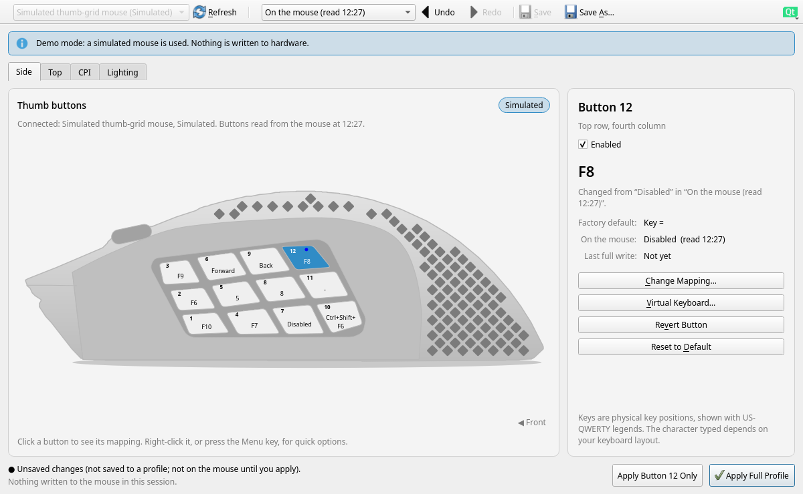

# RatCommander

**A Linux button editor for the SteelSeries Aerox 9 Wireless.** Pick a button on the mouse diagram, give it a new mapping, and save it to the mouse. You can also tune CPI presets, polling rate, and lighting.

[Install](#install) · [Remap one button](#remap-one-button) · [Hardware support](#hardware-support) · [Development](#development)



*Button 12 is disabled on the simulated mouse. F8 is the pending edit.*

## Install

Look for the package for your distribution on the [GitHub Releases page](https://github.com/galdorork/ratcommander-linux/releases). From the download directory, run the matching command with the filename you downloaded. Both packages include the desktop launcher and USB access rule.

| Distribution | Package | Install |
| --- | --- | --- |
| Arch Linux / Manjaro | `.pkg.tar.zst` | `sudo pacman -U ./<filename>.pkg.tar.zst` |
| Ubuntu 26.04 LTS | `.deb` | `sudo apt install ./<filename>.deb` |

Ubuntu uses Qt and HID packages from **Universe**. If your release has no package for your distro, use the source instructions below.

<details>
<summary><strong>Install from source</strong> · Linux and Python 3.11+</summary>

From the repository root:

```sh
python3 -m venv .venv
. .venv/bin/activate
pip install -e '.[device]'
```

For hardware access, install the rule for the two supported USB device IDs, reload the rules, then reconnect the receiver or cable.

```sh
sudo install -m644 packaging/70-aerocommand.rules /etc/udev/rules.d/
sudo udevadm control --reload-rules
```

</details>

Launch **RatCommander** from your desktop menu or run `ratcommander`. To explore the editor with a simulated mouse, run `ratcommander --demo`.

## Remap one button

1. Connect the receiver or USB cable and open RatCommander. The **On the mouse** field shows the mapping read from the device.
2. On **Side** or **Top**, select a button and choose **Change Mapping…**. Use the **Enabled** checkbox to disable or re-enable it.
3. Choose **Apply Button 12 Only** if you selected button 12. The action follows your selection and becomes available when its mapping differs from the mouse.

To move **Left click**, assign and apply it to the replacement button first. You can then disable the original. RatCommander checks that the mouse keeps a working left click.

### What gets written?

| Action | What RatCommander does |
| --- | --- |
| **Apply Button X Only** | Reads and backs up the live button table, replaces the selected field, sends the three table pages, and checks all 20 mappings. The other 19 fields keep their original bytes. |
| **Apply Lighting Only** | Sends the lighting values set in the editor. Setting zone colours sends all three displayed colours. |
| **Apply Full Profile** | Writes all 20 mappings and each setting specified by the profile, saves to onboard memory, and checks the values the mouse can report. |

**Save** and **Save As** store profiles locally. Before a hardware write, RatCommander backs up the current readable settings. To restore them, open **Backups…** from the application menu, load a backup, review it, and choose **Apply Full Profile**.

Profiles live in `${XDG_CONFIG_HOME:-~/.config}/aerocommand/profiles.json`, alongside the `backups/` folder. Upgrading from AeroCommand preserves this location and the `aerocommand` launch command.

## Hardware support

**Tested on one standard Aerox 9 Wireless.** The WoW Edition and other models are outside the current support list.

| Connection | USB ID | Hardware result |
| --- | --- | --- |
| 2.4 GHz receiver | `1038:1858` | Button read, write, persistence, and restore verified. |
| USB cable | `1038:185a` | Button read, write, persistence, and restore verified. |
| Bluetooth | — | Configuration unsupported. |

With the 2.4 GHz receiver selected, the connection status shows the mouse battery percentage. RatCommander checks every 30 seconds and shows **Battery unavailable** when the receiver cannot provide a valid reading.

On the tested mouse, button bindings survived a power cycle, while polling returned to 1000 Hz. Persistence of the other settings still needs testing. The mouse accepts zone colours but cannot report them, so a backup cannot restore previous zone colours. [Hardware test results](docs/HARDWARE-RESULTS.md)

## Desktop integration

RatCommander selects a compact toolbar and centred section switcher on GNOME. KDE Plasma and other desktops use the standard toolbar and tabs. Preview either layout with `ratcommander --demo --layout gnome` or `ratcommander --demo --layout kde`.

With a system tray, closing the window keeps your draft available from the mouse icon. Choose **Open RatCommander** to return or **Quit RatCommander** to exit. Without a tray, closing the window exits.

## Development

<details>
<summary><strong>Run the tests and simulate device failures</strong></summary>

In an active virtual environment:

```sh
pip install -e '.[test]'
QT_QPA_PLATFORM=offscreen python -m pytest -q
ratcommander --demo --demo-scenario interrupt --demo-delay 2
```

Demo scenarios include `success`, `no-device`, `no-permission`, `reject`, and `interrupt`. Minimal Linux systems may need `libegl1` and `libxkbcommon0` for Qt.

</details>

<details>
<summary><strong>Build release packages</strong></summary>

Run **Actions → Release packages → Run workflow** for a rehearsal. To publish packages, create a GitHub Release or prerelease with a tag matching the version in `pyproject.toml` (for example, `v0.1.2` for `0.1.2`). The tagged commit must include the workflow and the release must allow asset updates.

The workflow builds an Arch package and an Ubuntu 26.04 LTS package, installs each in its distribution, runs the offscreen tests, and attaches the installers after both jobs pass. [Release workflow](.github/workflows/release-packages.yml)

</details>

[Hardware verification checklist](docs/HARDWARE-VERIFICATION.md) · [Protocol notes](docs/BACKEND-NOTES.md) · [Product spec](docs/PRODUCT-SPEC.md) · [Implementation plan](docs/IMPLEMENTATION-PLAN.md) · [Original handoff](docs/HANDOFF-README.md)

## Credits and license

RatCommander implements the device protocol documented by Fabien Loison and the [Rivalcfg contributors](https://github.com/flozz/rivalcfg) (WTFPL), including Zebreus’s [Aerox 9 button-mapping work](https://github.com/flozz/rivalcfg/pull/243). It uses [hidapi](https://github.com/trezor/cython-hidapi) for device access and [Qt for Python](https://doc.qt.io/qtforpython-6/) (PySide6, available under LGPLv3) for the desktop UI.

RatCommander is independent of SteelSeries ApS. Product names identify compatible hardware. SteelSeries does not endorse or support the project, and the repository contains no SteelSeries software, artwork, or decompiled code.

RatCommander is free software under the [GNU General Public License, version 3 or later](LICENSE).
